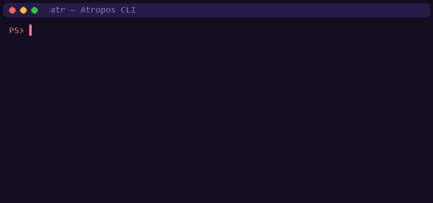

<p align="center"></p>

<h1 align="center">Atropos</h1>
<p align="center"><b>Cut the right thread.</b><br>A process manager for developers on Windows: from a port to the process that owns it, and a safe way to stop it — or its whole tree.</p>

<p align="center"></p>

> A recording of a subtree kill in the GUI is still to come (see [Contributing](CONTRIBUTING.md)).

## Why

"Port 3000 is already in use." Task Manager can't tell you who holds it; `netstat -ano` gives you a PID you then have to look up, and killing that PID can hit an unrelated process if the PID was reused in the meantime. Atropos goes straight from the port to the process, shows what it really is, and stops it — politely first, then by force — without ever addressing a bare PID.

## Install

| Method | Command / file | Admin? |
|---|---|---|
| Portable zip | `atropos-<version>-windows-x64.zip` from [Releases](https://github.com/suchetkumbar/Atropos/releases): unzip anywhere and run | No |
| MSI (per user) | `atropos-<version>-windows-x64.msi` — installs to `%LOCALAPPDATA%\Programs\Atropos` and puts `atr` on your PATH | No |
| winget | `winget install Atropos.Atropos` *(once published)* | No |
| Scoop | `scoop install atropos` *(once published)* | No |

No runtime to install (the C runtime is linked statically), no configuration, no service, no network. Releases are built for x64 and ARM64.

**First run of a download:** unsigned builds trigger SmartScreen ("More info → Run anyway"), and Windows 11 **Smart App Control blocks unsigned apps entirely** until releases are code-signed — see [signing notes](docs/notes/signing.md).

## Command line: `atr`

```text
atr port 3000                 who owns port 3000 (TCP/UDP, IPv4/IPv6)
atr port 3000 --kill          end it (asks first; --yes to skip)
atr port 3000 --kill --tree   end it and everything it started
atr find node                 search: text, pid:123, user:me, name:node, :3000
atr kill 4242 --dry-run       show what would happen; change nothing
atr kill 4242 --console       end everything started from that terminal window (keeps the shell)
atr tree [pid]                process tree
atr wait-port 3000            wait until the port is free (CI scripts)
atr                           open the GUI
```

Every command takes `--json` (`"schema": 1`). Exit codes are stable for scripts: `port` 0 found/done · 1 none · 2 denied · 3 stuck; `find` 0/1; `kill` 0 done · 2 denied/protected · 3 stuck; `wait-port` 0 free · 4 timeout.

## The GUI

- Every process, flat or as a tree, with CPU %, memory (private working set, as Task Manager shows it), threads, handles, disk read/write per second, user and start time; CPU and memory sparklines.
- **Readable names:** "Next.js dev · shop", "Django dev · blog", "cargo run · atropos", "VS Code extension host" instead of five rows of `node.exe` (the executable stays in the tooltip). Rules cover Next.js, Vite, Create React App, Angular, Nuxt, nodemon, ts-node/tsx, Django, Flask, FastAPI/uvicorn, Jupyter, cargo, dotnet, Spring Boot, Gradle, Docker Desktop, WSL, VS Code helpers, language servers and Chrome/Edge.
- Search with the same syntax as `atr find`; `:3000` finds the owner of a port; labels and `cwd:` are searchable too.
- **Projects:** processes grouped by the git repository they run in, with "End everything from `<repo>`".
- **Leftovers:** dev servers still listening on a port after the terminal that started them is gone.
- Details: executable, command line, parent chain, environment (secrets such as tokens and keys are hidden until you click *Show*), and open ports with Docker/WSL forward badges.
- Rows hold still under your mouse; the selection follows the process, not the row.
- `Del` end · `Shift+Del` end tree · `Ctrl+P` suspend/resume · `/` search · `T` tree · `F5` refresh · `?` all shortcuts.
- Denied? **Retry as administrator** asks Windows once (UAC) and runs the action through a short-lived helper.

## Safety

- **Never a bare PID:** each action opens the process, re-checks its start time, and acts only through that handle — a reused PID can't be hit by mistake.
- **Graceful first:** stops the services it hosts, closes its windows, or sends Ctrl+C; forces only after the grace period (5 s by default).
- **Honest outcomes:** exited, terminated, denied, protected, gone, or stuck.
- **Subtree kills catch fork storms:** the tree is frozen, contained in a Job Object, and nothing it spawns survives.
- **Protected list:** core Windows processes, Atropos itself and its parents are never touched; the desktop shell and other users' processes need you to type the name.
- **Crash-safe:** if Atropos ever crashes while processes are suspended, the next start offers to resume them.
- **Warns before a pointless kill:** if a Windows service, `nodemon`, `pm2`, `dotnet watch`, `cargo watch`, Task Scheduler or Docker would just start the process again, the dialog says so and offers the right action instead.

## Your own labels

Labels work with no configuration. To add your own, put rules in `%APPDATA%\Atropos\config.toml`; they are tried before the built-in ones, and a broken rule is reported and skipped without affecting the rest.

```toml
[[labels]]
image = ["node"]                       # executable name without .exe; omit for any
cmdline = '(?i)[\\/]api[\\/]server\.js'   # regex searched in the command line (optional)
markers = ["package.json"]             # files that must exist in the working directory (optional)
label = "Orders API · {project}"       # {project} = package.json / Cargo.toml name, else the folder
```

## Compared with…

| | Atropos | Task Manager | Process Explorer | btop |
|---|---|---|---|---|
| Port → process | ✅ GUI + CLI | ❌ (Resource Monitor only) | ⚠️ per-process TCP/IP tab | ❌ |
| Safe against PID reuse | ✅ | — | — | — |
| Graceful stop, then force | ✅ (service / window / Ctrl+C) | ❌ ends immediately | ⚠️ kill only | ⚠️ signals (Unix) |
| Subtree kill that survives fork storms | ✅ Job Object | ✅ "End process tree" | ✅ "Kill process tree" | ⚠️ |
| Scriptable CLI with JSON + exit codes | ✅ `atr` | ❌ | ❌ | ❌ |
| Environment with secret masking | ✅ | ❌ | ⚠️ (shown in clear) | ❌ |
| Install without admin | ✅ | built in | ✅ (portable) | ✅ |
| Network / telemetry | none | Windows | none | none |

## Privacy

Atropos makes **no network calls** and sends **no telemetry**. It writes only its logs (`%LOCALAPPDATA%\Atropos\logs`), your settings once you change one (`%APPDATA%\Atropos\config.toml`), and a suspend journal while processes are suspended.

## Build from source

Windows 10 1809+ / 11, Rust (pinned in `rust-toolchain.toml`), Visual Studio Build Tools with the C++ workload.

```powershell
cargo build --release --workspace          # target\release\Atropos.exe, atr.exe
cargo test --workspace
pwsh scripts/perf.ps1 -Mode all            # budgets: startup, memory, CPU, size, CLI
pwsh scripts/package.ps1                   # dist\ zip (+ MSI when WiX is installed)
```

## License

Dual-licensed under [MIT](LICENSE-MIT) or [Apache-2.0](LICENSE-APACHE), at your option.
